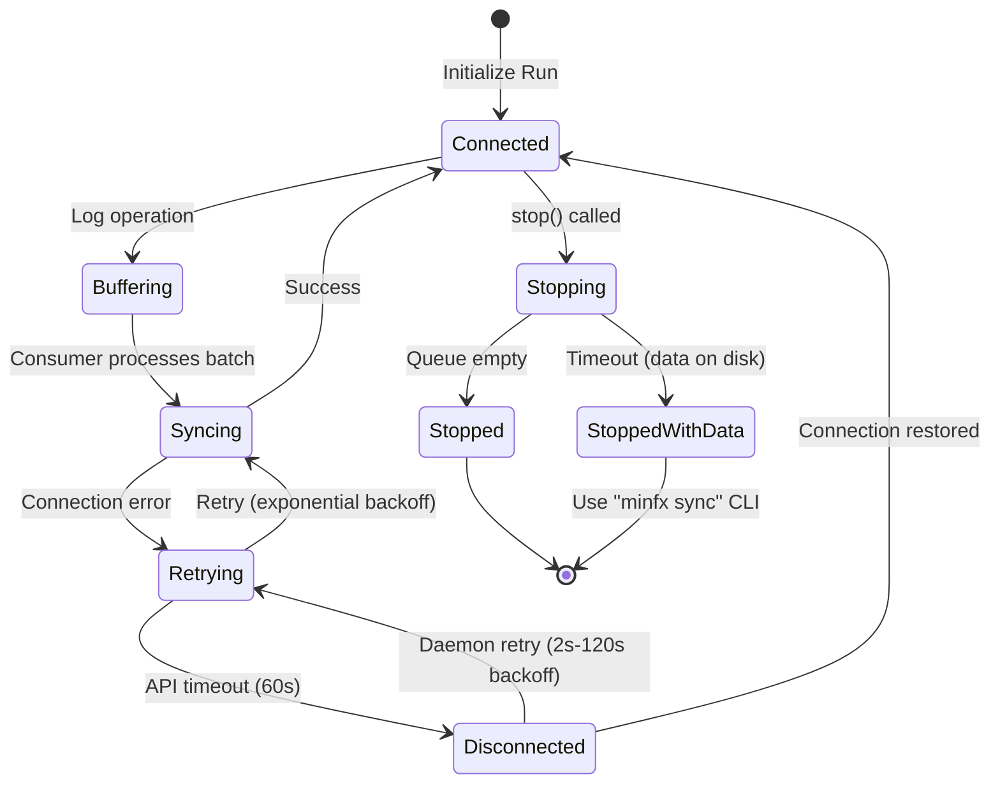

# neptune_v2

Legacy Neptune v2 client bundled with minfx for experiment tracking.

## Purpose

> [!IMPORTANT]
> This is the legacy client.
> For the new Neptune client, go to [`neptune-client-scale`].

> [!NOTE]
> If you need to access Neptune Legacy (app version [`2.x`]), see the
> [`legacy documentation`] for setup instructions.

The neptune_v2 SDK is designed to be resilient to network issues.
It implements a multi-layer retry and buffering strategy to ensure no data is
lost during connection problems.
[`__init__.py`] exports [`init_run()`], [`init_model()`],
[`init_model_version()`], and [`init_project()`] for Neptune objects.

### Support

If you get stuck or want to talk to us, use the Legacy app chat or email
[support@neptune.ai](mailto:support@neptune.ai).

### Connection Handling

The client supports multiple connection modes and disk-backed buffering for
offline and async operation.

### Connection Modes

| Mode | Description | Buffering | Retries |
|------|-------------|-----------|---------|
| [`async`] (default) | Background syncing | Disk-based | Yes |
| [`sync`] | Immediate API calls | None | Yes |
| [`offline`] | No network | Disk-based | N/A |
| [`debug`] | Mock backend | Memory | N/A |

### Buffering (Async Mode)

In [`async`] mode, all operations are immediately written to a local disk queue
before being sent to the server:

- **Location**: [`.neptune/async/<container_id>/`]
- **Files**: [`data-*.log`] (operations), [`last_put_version`],
  [`last_ack_version`]
- **Persistence**: Data survives process crashes and can be synced later via
  [`minfx sync`] CLI

### Retry Strategy

#### API Level (per-request)

- **Timeout**: 60 seconds total (configurable via
  [`NEPTUNE_RETRIES_TIMEOUT_ENV`])
- **Backoff**: Exponential [`2^n`] seconds, capped at 30 seconds
- **Handled errors**: Connection errors, timeouts, HTTP 5xx, 429 (rate limit)

#### Daemon Level (background thread)

- **Retries**: Infinite while the daemon is running
- **Initial backoff**: 2 seconds
- **Max backoff**: 120 seconds (doubles each failure)
- **Recovery**: Logs "Communication with Neptune restored!" when connection
  recovers

### Shutdown Behavior

When [`stop()`] is called on a run:

1. Disables sleep and wakes the consumer thread
2. Waits for the queue to empty (default: 60s timeout via
   [`NEPTUNE_SYNC_AFTER_STOP_TIMEOUT`])
3. If connection is lost during stop: waits for reconnection up to the timeout
4. On success: removes local data files
5. On timeout: keeps data on disk for manual sync via [`minfx sync`]

### State Machine

### Environment Variables

| Variable | Default | Description |
|----------|---------|-------------|
| [`NEPTUNE_RETRIES_TIMEOUT`] | 60 | API retry timeout in seconds |
| [`NEPTUNE_SYNC_AFTER_STOP_TIMEOUT`] | 60 | Wait time for queue sync on stop |
| [`NEPTUNE_ASYNC_BATCH_SIZE`] | 1000 | Operations per batch |

## Subdirectories / Files

- `./api/` - Public API for fetching and querying Neptune data.
- `./apis/` - OpenAPI JSON specifications for backend services.
- `./attributes/` - Attribute system for experiment data types.
- `./cli/` - Command-line tools for sync, status, and cleanup.
- `./common/` - Shared utilities, exceptions, and environment constants.
- `./core/` - Operation storage, queuing, and metadata components.
- `./integrations/` - ML framework integrations for automatic logging.
- `./internal/` - Internal backends, operation processors, and utilities.
- `./logging/` - Python logging integration for Neptune string series.
- `./management/` - Workspace and project management API.
- `./metadata_containers/` - Run, Project, Model, and ModelVersion containers.
- `./types/` - Value type definitions and the Neptune type system.
- `./vendor/` - Vendored third-party libraries bundled with Neptune.
- `./__init__.py` - Public package exports and init functions.
- `./CHANGELOG.md` - Release history and version notes.
- `./CITATION.cff` - Citation metadata for the Neptune client.
- `./CODE_OF_CONDUCT.md` - Community code of conduct.
- `./codecov.yml` - Code coverage configuration.
- `./constants.py` - Package-wide constants including directory names.
- `./dev_requirements.txt` - Development dependency pins.
- `./envs.py` - Environment variable name constants.
- `./exceptions.py` - Neptune client exception types.
- `./handler.py` - Attribute access handler for container namespaces.
- `./LICENSE` - Apache 2.0 license text.
- `./poetry.lock` - Locked dependency versions for Poetry builds.
- `./progress_bar.py` - Progress bar utilities for uploads and downloads.
- `./py.typed` - PEP 561 marker for type checking.
- `./pyproject.toml` - Poetry project metadata and dependencies.
- `./table.py` - Table attribute type for structured data.
- `./typing.py` - Shared typing helpers and type aliases.
- `./utils.py` - General-purpose client utilities.
- `./version.py` - Package version string.

## Usages

- Import as import minfx.neptune_v2 as neptune for a drop-in Neptune client.
- Call [`init_run()`], [`init_model()`], [`init_model_version()`], or
  [`init_project()`] to create or connect to Neptune objects.
- Use [`async`], [`sync`], [`offline`], or [`debug`] modes when initializing
  containers to control buffering and network behavior.
- Run [`minfx sync`] to upload buffered data from
  [`.neptune/async/<container_id>/`] after crashes or timeouts.
- Configure retries and shutdown via [`NEPTUNE_RETRIES_TIMEOUT`],
  [`NEPTUNE_SYNC_AFTER_STOP_TIMEOUT`], and [`NEPTUNE_ASYNC_BATCH_SIZE`].

[`2.x`]: https://docs-legacy.neptune.ai/setup
[`async`]: types/mode.py
[`sync`]: types/mode.py
[`offline`]: types/mode.py
[`debug`]: types/mode.py
[`.neptune/async/<container_id>/`]: constants.py
[`data-*.log`]: core/components/queue/disk_queue.py
[`last_put_version`]: core/components/queue/disk_queue.py
[`last_ack_version`]: core/components/queue/disk_queue.py
[`minfx sync`]: cli/commands.py
[`NEPTUNE_RETRIES_TIMEOUT_ENV`]: common/envs.py
[`NEPTUNE_RETRIES_TIMEOUT`]: common/envs.py
[`2^n`]: common/backends/utils.py
[`stop()`]: metadata_containers/run.py
[`NEPTUNE_SYNC_AFTER_STOP_TIMEOUT`]: envs.py
[`NEPTUNE_ASYNC_BATCH_SIZE`]: envs.py
[`__init__.py`]: __init__.py
[`init_run()`]: __init__.py
[`init_model()`]: __init__.py
[`init_model_version()`]: __init__.py
[`init_project()`]: __init__.py
[`neptune-client-scale`]: https://github.com/neptune-ai/neptune-client-scale
[`legacy documentation`]: https://docs-legacy.neptune.ai/setup

---
2026-11-05T16:01:08
